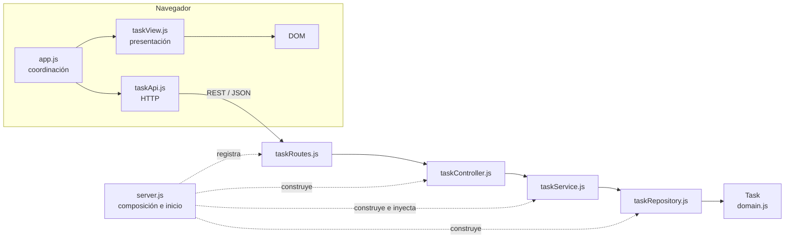

# Documentación de arquitectura — Taller práctico 3.4

## 1. Introducción

Este documento describe la arquitectura comprobada del gestor de tareas del repositorio `crgonzalez3212/Guia5Arquitectura` y los cambios realizados para desarrollar el punto 3.4 de la guía de aprendizaje del SENA. Distingue las capas que ya existían en el backend de la separación aplicada al frontend.

## 2. Objetivo del taller

Aplicar el principio de Separación de Responsabilidades para que la comunicación con la API, la presentación de datos y la coordinación de interacciones puedan comprenderse y modificarse de forma más independiente, manteniendo las funciones existentes y verificando su comportamiento.

## 3. Descripción del proyecto base

El proyecto es un gestor sencillo de tareas con una API REST y una interfaz web estática:

- **Backend:** JavaScript en Node.js, Express y CORS. Expone `GET /api/health`, operaciones para listar y crear tareas y una operación para cambiar su estado. Los datos viven en memoria.
- **Frontend:** HTML, CSS y JavaScript del navegador. Permite listar tareas, crear una tarea y actualizar su estado.
- **Dependencias de runtime declaradas:** `express` y `cors` en `backend/package.json`. No se agregó ninguna dependencia para las pruebas; se usa `node:test`.
- **Ejecución base:** el backend se inicia desde `backend/`; el frontend se sirve como contenido estático.

No se encontró una suite de pruebas ni un script de pruebas en el `package.json` original.

## 4. Problemas de separación de responsabilidades identificados

En la versión original, `frontend/src/app.js` concentraba tres grupos de tareas:

1. **Transporte:** creación de solicitudes `fetch`, cabeceras, lectura de respuestas y traducción de errores HTTP.
2. **Vista:** escape de texto y generación/inserción del HTML de cada tarea, además del estado visual de la API.
3. **Coordinación de la pantalla:** selección de elementos del DOM, eventos de formulario y botones, llamadas a la API y mensajes de resultado.

Estas tareas estaban acopladas en un único archivo. Un cambio de presentación, por ejemplo, convivía con el código de red y los controladores de eventos. La solución implementada mueve el transporte a `taskApi.js` y la presentación a `taskView.js`, dejando `app.js` como coordinador.

El backend ya separaba rutas, controlador, servicio y repositorio. `TaskService` contiene las validaciones de negocio y recibe el repositorio por constructor; por ello no se modificaron esas capas. El repositorio usa memoria y no una base de datos, pero esto coincide con el alcance didáctico y con el mensaje de la interfaz que advierte que los datos se reinician al detener el backend.

## 5. Arquitectura seleccionada: MVC

Se documenta una arquitectura **MVC con capas de servicio y repositorio**, no una implementación completa de Clean Architecture. Esta elección corresponde al código real: existen rutas/controlador en el backend y una interfaz que cumple el papel de vista. El servicio y el repositorio mantienen las reglas de negocio y el acceso a datos separados.

En el navegador, el controlador de la interfaz (`app.js`) coordina el cliente (`taskApi.js`) y la vista (`taskView.js`). En el servidor, las rutas dirigen las peticiones al controlador, que invoca el servicio; el servicio usa el repositorio inyectado.

## 6. Estructura de carpetas antes y después

### Antes

```text
backend/
  package.json
  src/
    domain.js
    server.js
    taskController.js
    taskRepository.js
    taskRoutes.js
    taskService.js
frontend/
  index.html
  styles.css
  src/
    app.js
```

`app.js` contenía conjuntamente las solicitudes HTTP, la construcción de la vista y la coordinación de eventos.

### Después

```text
backend/
  package.json
  src/
    domain.js
    server.js
    taskController.js
    taskRepository.js
    taskRoutes.js
    taskService.js
  test/
    taskService.test.js
frontend/
  index.html
  styles.css
  src/
    app.js
    taskApi.js
    taskView.js
CAMBIOS_PUNTO_3_4.md
DOCUMENTACION_ARQUITECTURA.md
```

`index.html` carga `app.js` como módulo ES nativo para permitir sus importaciones.

## 7. Responsabilidades de los módulos principales

| Módulo | Responsabilidad |
|---|---|
| `backend/src/domain.js` | Representa una tarea y sus datos básicos: identificador, título, descripción, estado y fecha de creación. |
| `backend/src/taskService.js` | Implementa los casos de uso y valida título, estado y existencia de la tarea. |
| `backend/src/taskRepository.js` | Mantiene y consulta la colección de tareas en memoria. |
| `backend/src/taskController.js` | Traduce solicitudes HTTP de tareas a operaciones del servicio y delega errores al middleware. |
| `backend/src/taskRoutes.js` | Asocia métodos y rutas HTTP con las acciones del controlador. |
| `backend/src/server.js` | Configura Express, middleware, composición de dependencias, rutas y arranque del servidor. |
| `frontend/src/app.js` | Controla eventos de la interfaz y coordina API y vista. |
| `frontend/src/taskApi.js` | Encapsula las solicitudes HTTP para las operaciones de tareas. |
| `frontend/src/taskView.js` | Renderiza tareas y mensajes visuales, escapando el contenido textual antes de insertarlo como HTML. |
| `backend/test/taskService.test.js` | Verifica reglas y resultados del servicio sin depender de Express ni de la interfaz. |

## 8. Separación de modelos, servicios, controladores y repositorios

El modelo `Task` está en `domain.js`. Las reglas de aplicación comprobadas —por ejemplo, que el título tenga al menos tres caracteres y que el estado pertenezca a los valores admitidos— están en `TaskService`. El controlador no accede directamente a la colección: invoca el servicio. El servicio recibe un `TaskRepository` por inyección de dependencias y delega allí la consulta y modificación de datos.

La vista del navegador no conoce los detalles de `fetch`: los obtiene mediante `taskApi.js`. El módulo coordinador invoca las operaciones y entrega los datos o mensajes a `taskView.js`. No se añadió repositorio de frontend ni capa de persistencia nueva porque no son necesarios para este cliente web y la persistencia existente está en el backend.



## 9. Mejoras comprobadas en cohesión y acoplamiento

- La comunicación HTTP, la presentación y la coordinación de eventos dejaron de estar implementadas en el mismo `app.js`.
- La vista y el cliente de API tienen interfaces explícitas por medio de funciones exportadas e importadas, y no requieren dependencias externas adicionales.
- Las validaciones de negocio existentes siguen centralizadas en `TaskService`; el repositorio y el controlador no fueron reescritos.
- Se incorporaron seis pruebas del servicio. La integración HTTP y el flujo de la interfaz también se comprobaron con una tarea creada y actualizada.
- La persistencia continúa acoplada al repositorio en memoria, como estaba en el proyecto base. Reemplazarla por una base de datos requeriría otro cambio y no forma parte de esta refactorización.

## 10. Pruebas y resultados reales

- `npm test` ejecutado desde `backend/`: **6 aprobadas, 0 fallidas**.
- `node --check` sobre `frontend/src/app.js`, `frontend/src/taskApi.js`, `frontend/src/taskView.js` y los seis módulos de `backend/src/`, además del archivo de pruebas: **sin errores de sintaxis**.
- Verificación HTTP: salud (`/api/health`), listado, creación y actualización de estado mediante la API: **completada correctamente**.
- Verificación en navegador: cargar tareas, crear una tarea y cambiar su estado a `finalizada`: **completada correctamente tras recargar la página después de un error transitorio de carga de recurso**.
- `git diff --check`: **sin errores**.

Los comandos se ejecutan desde `backend/` para las pruebas del backend. No se ejecutaron pruebas automatizadas de frontend ni pruebas sobre otros navegadores o versiones de Node.js.

## 11. Conclusiones

El backend ya tenía una separación adecuada para el alcance de este taller, así que se conservó. La refactorización se concentró en el problema comprobado del frontend: separar el cliente HTTP y la vista del código coordinador. Las pruebas del servicio y las verificaciones HTTP y de navegador aportan evidencia de que se preservaron las operaciones principales. El almacenamiento en memoria y la falta de pruebas automatizadas específicas del frontend permanecen como límites explícitos del proyecto.
